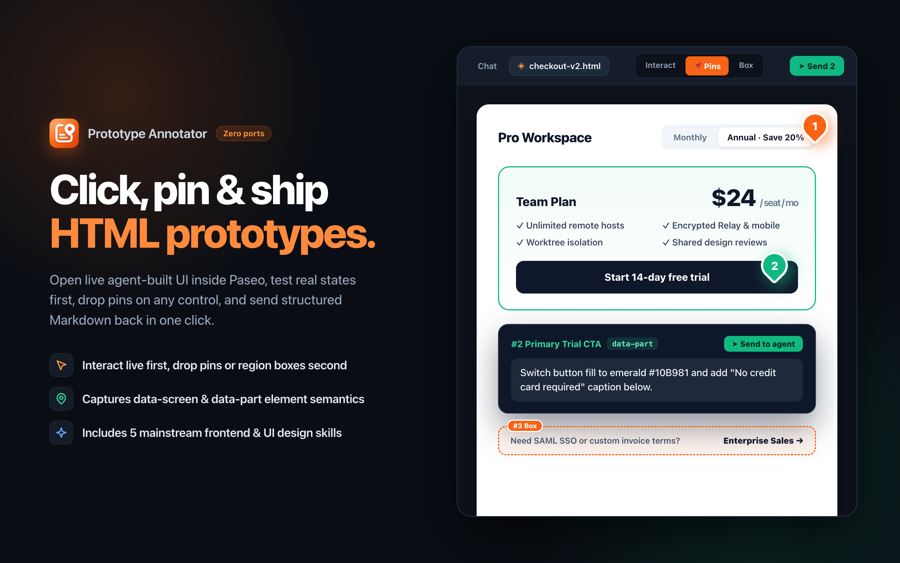
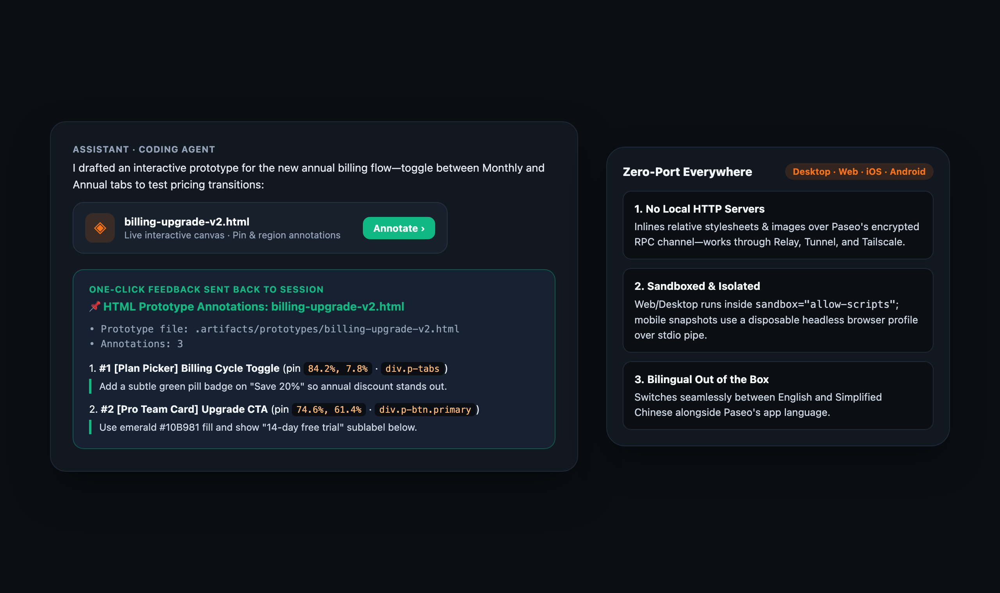

# Prototype Annotator for Paseo

[简体中文](./README.zh-CN.md)

**Prototype Annotator** (`html-prototype-annotator`) is an open-source [Paseo](https://paseo.sh) plugin for reviewing interactive `.html` UI prototypes generated by AI coding agents—without starting local HTTP servers, opening firewall ports, or manually copying element selectors.



## Why Prototype Annotator?

When collaborating with coding agents on new screens, layout revamps, or multi-state dialogs, static screenshots hide interaction bugs while full framework builds slow down iteration. Self-contained `.html` prototypes hit the sweet spot—until you try to preview them across a remote daemon or mobile phone, or explain *"move the second pill button inside the billing drawer 8px up"* in plain text.

Prototype Annotator closes that loop inside Paseo:

1. **Zero-port encrypted transport**: reads `.html`/`.htm` on the daemon host, inlines relative `<link rel="stylesheet">` and `` assets automatically (up to 64 MB bundled total), and streams large prototypes in 1.5 MB chunks—works seamlessly over Desktop, Web, Paseo Relay, Cloudflare Tunnel, Tailscale, iOS, and Android.
2. **Test interactions first, pin second**: opens in **Interact** mode (`pointer-events: none` overlay) so tabs, modals, drawers, inner scroll lists, and vertical swipe feeds work naturally; switch to **Drop pins** or **Box region** anytime (or `Option`/`Alt` + click to trigger buttons while pinning).
3. **Semantic element capture**: extracts `data-screen`, `data-part`, DOM ancestor path, visible text snippet, short CSS selectors, and exact percentage coordinates—keeping pins anchored inside scrollable or dynamically switched screens across both desktop and full-stage (`100vh`) mobile viewports.
4. **One-click `<prototype-feedback>` handoff**: saves `.annotations.json` + `.annotations.md` sidecars next to the prototype, deduplicates previously sent pins on follow-up rounds, renders a collapsible feedback card right in the chat timeline, and dispatches structured `<prototype-feedback>` straight into your active Paseo agent session.



## Installation

From the Paseo plugin registry (once listed) or directly from GitHub:

```bash
# From the official Paseo plugin registry
paseo plugin add badyoung/html-prototype-annotator

# Or directly from GitHub
paseo plugin add git:badyoung/html-prototype-annotator
```

Requires **Paseo `>= 0.14.0`** on macOS, Linux, or Windows. Zero runtime npm dependencies.

## Usage

- **From chat**: ask your agent to save an interactive HTML prototype (for example `.artifacts/prototypes/checkout.html`) and output a `file://` link `[checkout.html](file:///abs/path/checkout.html)`—click the rendered prototype card in chat.
- **From Workspace Explorer**: right-click or open any `.html` / `.htm` file and choose **Open with → Prototype Annotator**.
- **Slash command / Command Center**: run `/proto path/to/prototype.html` in any agent composer, or open **HTML Prototype Studio…** from `⌘K` / `Ctrl+K`.

### Recommended `data-screen` & `data-part` Convention for Agents

When **Auto-guide top-level agents** is enabled in **Settings → Plugins → Prototype Annotator** (on by default), top-level sessions automatically learn this lightweight convention—or you can copy the snippet from Settings into your repo's `AGENTS.md`:

```html
<section data-screen="Checkout Drawer">
  <button data-part="Primary Pay CTA">Pay $29.00</button>
</section>
```

Plain HTML files without `data-screen` or `data-part` also work out of the box using `<title>`, ARIA labels, button text, and short CSS selectors.

## Bundled Frontend & Prototype Design Skills

Prototype Annotator bundles five pure-Markdown skills under [`skills/`](./skills) (zero scripts or binaries) so your coding agents craft distinctive, accessible UI prototypes instead of generic AI templates:

| Skill | Focus | License |
| --- | --- | --- |
| `html-prototype-craft` | Zero-port `.html` prototype workflow, live stateful interactions, and `data-screen` / `data-part` semantic instrumentation | MIT |
| `frontend-design` | Anthropic's flagship frontend design lead skill for intentional typography, subject-grounded palettes, and anti-AI-slop craft | Apache-2.0 |
| `baseline-ui` | Opinionated UI polish baseline for spacing, hierarchy, accessible primitives, and layout cleanup | MIT |
| `fixing-accessibility` | WCAG & ARIA audit rules for accessible names, keyboard navigation, focus traps, and form errors | MIT |
| `fixing-motion-performance` | Compositor-first (`transform` / `opacity`) motion rules to prevent layout thrashing and jank | MIT |

Install or remove them in one click from **Settings → Plugins → Prototype Annotator** (existing externally installed skills are automatically preserved), or install via the standard `skills` CLI:

```bash
npx skills add badyoung/html-prototype-annotator
```

See [THIRD_PARTY_NOTICES.md](./THIRD_PARTY_NOTICES.md) for upstream attributions.

## Security & Privacy Model

- **Sandboxed Web/Desktop frame**: prototypes render inside `<iframe sandbox="allow-scripts">` (opaque origin, no host DOM or storage access) communicating solely via token-authenticated `postMessage`.
- **Symlink-safe asset bundling**: relative CSS and image inlining resolves `realpath` on both the asset and parent directory ceiling to prevent symlink traversal outside the prototype folder.
- **Isolated headless mobile snapshots**: iOS/Android snapshot rendering spawns a local Chrome/Chromium/Edge/Playwright binary over `--remote-debugging-pipe` (zero TCP ports) using a disposable `--user-data-dir` cleaned up on exit—never touching your personal browser profile.

## Development

```bash
npm install --ignore-scripts
npm run typecheck
npm test
npm pack --dry-run --ignore-scripts
```

To load a local checkout into Paseo during development:

```bash
paseo plugin install /absolute/path/to/html-prototype-annotator
paseo plugin reload html-prototype-annotator
```

## Contributing & License

Contributions, bug reports, and focused improvements are welcome—please read [CONTRIBUTING.md](./CONTRIBUTING.md) and [CODE_OF_CONDUCT.md](./CODE_OF_CONDUCT.md) first.

Released under the [MIT License](./LICENSE).
