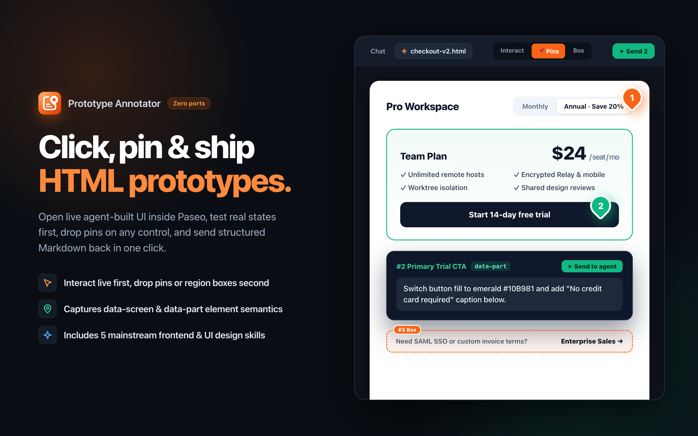
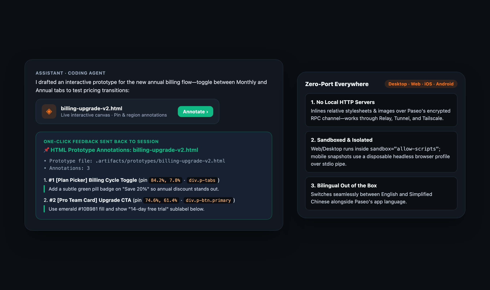

# Prototype Annotator · HTML 原型审稿与标注

[English](./README.md)

**Prototype Annotator**（`html-prototype-annotator`）是一款面向 [Paseo](https://paseo.sh) 的开源交互式 HTML 原型审稿与视觉打标插件：无需启动任何本地 HTTP 端口或内网穿透，直接预览 Agent 生成的 `.html` 界面原型、测试真实点击/弹窗交互、插入水滴图钉或框选区域，并一键将结构化 Markdown 修改意见打回当前会话。



## 核心特性

1. **零额外端口跨端直连**：服务端读取 `.html`/`.htm` 并自动内联相对引用的 `<link rel="stylesheet">` 与 `` 静态资源（经 `realpath` 防护软链越界），跨桌面端、Web 端、Paseo Relay、Tunnel、Tailscale 及 iOS/Android 手机端即点即用。
2. **先交互体验，再精准插针**：默认以「交互点击」态打开（标注层全程 `pointer-events: none` 透传手势），先直接点击测试 Tab、抽屉、弹窗与表单；随时切换「点按标注」或「框选区域」（支持按住 `Option`/`Alt` 临时穿透点击底层按钮）。
3. **语义锚定不漂移**：自动提取外层 `data-screen` 画板名、`data-part` 控件语义、无障碍标签与简短选择器，支持局部滚动容器与动态重绘锚定。
4. **草稿落盘 + 一键回传会话**：自动在 `<原型目录>/.annotations/` 下持久化 `.annotations.json` 与 `.annotations.md`，重开自动恢复图钉草稿，点击发送直接唤醒目标 Paseo 会话。
5. **原生中英双语切换**：随 Paseo 客户端语言自动切换英文与简体中文界面及回传 Markdown 语言。
6. **内置 5 套主流前端与交互原型设计 Skill**：随包附带 `html-prototype-craft`、`frontend-design`（Anthropic Apache-2.0）、`baseline-ui`、`fixing-accessibility` 与 `fixing-motion-performance`（MIT），支持在插件设置页一键安装/卸载（自动保护已有同名技能），或直接运行 `npx skills add badyoung/html-prototype-annotator`。



## 安装方式

```bash
# 从 Paseo 官方插件库安装
paseo plugin add badyoung/html-prototype-annotator

# 或直接从 GitHub 安装
paseo plugin add git:badyoung/html-prototype-annotator
```

环境要求：**Paseo `>= 0.14.0`**（支持 macOS / Linux / Windows 守护进程，零运行时第三方 npm 依赖）。

## 本地开发与校验

```bash
npm install --ignore-scripts
npm run typecheck
npm test
npm pack --dry-run --ignore-scripts
```

欢迎提交 Issue 与 PR，参与前请先阅读 [CONTRIBUTING.md](./CONTRIBUTING.md) 与 [CODE_OF_CONDUCT.md](./CODE_OF_CONDUCT.md)。采用 [MIT License](./LICENSE) 开源。
